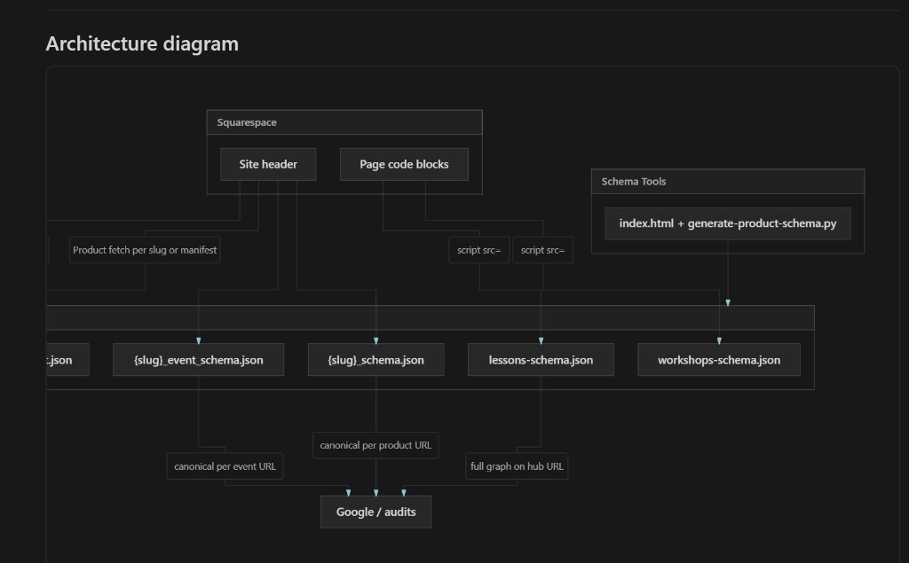

# Schema Architecture — Site-Wide Map

**Alan Ranger Photography — Schema Tools / alanranger-schema**  
**Document date:** 2026-06-01  
**Purpose:** Precise map of how JSON-LD is generated, hosted, and injected before indexing or collection-page optimisation decisions.

---

## Executive summary

| Question | Answer |
|----------|--------|
| Where is schema hosted? | `https://schema.alanranger.com/` (GitHub repo `alanranger/alanranger-schema`) |
| Product/Offer source of truth | **Individual product URLs** under `/photography-services-near-me/` and `/photo-workshops-uk/` — **not** collection parents |
| Event/Offer source of truth | **Individual event URLs** (`{slug}_event_schema.json`) — collection hubs **also duplicate** full event catalog in aggregate JSON |
| Safe to noindex product collections? | **Yes** for Product/Offer rich results (detail pages hold schema) |
| Safe to noindex event collections only? | **Low risk** if detail pages stay indexed — removes hub duplicate schema, not per-event schema |
| Keep URLs in 06-site-urls.csv? | **Yes** — inventory, audits, chat event mapping, manifests; separate from indexation |

---

## 1. Hosting and pipeline

| Layer | What |
|-------|------|
| **Generator** | Schema Tools: `index.html` + `scripts/generate-product-schema.py` |
| **Published JSON** | Submodule/repo: `alanranger/alanranger-schema` |
| **CDN** | `https://schema.alanranger.com/{filename}.json` (GitHub Pages + custom domain) |
| **Squarespace** | Site header injection and/or per-page Code blocks (not versioned in Schema Tools git) |

Production uses **`schema.alanranger.com`**, not `raw.githubusercontent.com` at page load.

**Update workflow:** Generate in Schema Tools → deploy JSON to `alanranger-schema` → push → GitHub Pages refreshes → Squarespace scripts reference new URLs.

---

## 2. Dynamic (GitHub-hosted) schema — by mechanism

### 2.1 Product detail pages

| Item | Detail |
|------|--------|
| **Generator function** | `schema_to_script_tag_html()` in `scripts/generate-product-schema.py` (approx. lines 2132–2314) |
| **Hosted files** | `{slug}_schema.json`, optional `{slug}_faq.json` |
| **Manifest** | `products-manifest.json` (path → file mapping; ~57 products) |
| **Injection** | Documented as site-wide Squarespace **header** loader; per-product `{slug}_schema_script_tag.html` also generated |
| **Mechanism** | Client-side `fetch(schema.alanranger.com/…)` → inline `<script type="application/ld+json">` appended to `document.head` |
| **Suppressor** | Schema Suppressor v1.3 (`partials/schema-suppressor-v1.3.html`) removes thin Squarespace native Product JSON-LD before inject |
| **URL patterns** | `/photography-services-near-me/{slug}` and `/photo-workshops-uk/{slug}` only — **not** parent collection URLs |

**Schema types injected:** `Organization`, `LocalBusiness`, `BreadcrumbList`, `Product` (with `Brand`, `Offer`, shipping/return policy). Optional second fetch: `FAQPage`.

**Not in product fetch script:** `Event`, `Course` (product generator is Product-only in script-tag output).

---

### 2.2 Event detail pages

| Item | Detail |
|------|--------|
| **Generator** | `buildPerEventArtifacts()` in Schema Tools `index.html` (approx. lines 13944–13999) |
| **Hosted files** | `{slug}_event_schema.json`, `{slug}_event_faq.json` |
| **Manifest** | `events-manifest.json` (~99 entries) |
| **Loader** | `getEventPostsLoaderScript()` — **ARP Event Loader v1.0** (approx. lines 14002–14167) |
| **Injection** | Squarespace **header** (“Copy Global Event Posts Loader”) |
| **URL patterns** | `/photographic-workshops-near-me/{slug}` and `/beginners-photography-lessons/{slug}` |

**Schema types on detail:** Hybrid `["Product","Event"]`, `BreadcrumbList`, nested `Organization`, `Place`, `PostalAddress`, `GeoCoordinates`, `Person` (performer), **`Offer`** (price), `WebPage`; optional `FAQPage` from `_event_faq.json`.

**Not used:** Standalone `Course` type (events use Product+Event hybrid).

**Hub behaviour:** On collection hub paths, loader runs but **`appendJsonLd` is skipped** for the full event graph (`isHubPath`). Hub gets minimal inline `WebPage` + optional TLDR only.

---

### 2.3 Event collection pages (aggregate)

| Page | Hosted file | Injection |
|------|-------------|-----------|
| `/photographic-workshops-near-me` | `workshops-schema.json` | Page **Code block**: `<script type="application/ld+json" src="https://schema.alanranger.com/workshops-schema.json">` |
| `/beginners-photography-lessons` | `lessons-schema.json` | Same pattern |

**Generator:** `generateEventSchema()` builds `@graph`: `[ItemList, …breadcrumbs, …all event nodes]`.

**Schema types on collection (not navigational-only):**

- `ItemList` (URLs to all events)
- One `BreadcrumbList` per event (embedded in aggregate)
- Full `["Product","Event"]` node per event with dates, location, **`Offer`/price**
- Optional `EventSeries` when “group repeating events” is enabled

**Plus on hub:** ARP Event Loader adds inline `WebPage` + TLDR; does **not** re-inject per-event graph from manifest on hub paths.

---

### 2.4 Product collection pages

| Page | Hosted aggregate? | Loader? |
|------|-------------------|---------|
| `/photography-services-near-me` | **No** aggregate JSON in repo | **No** manifest-driven schema for parent |
| `/photo-workshops-uk` | **No** | **No** |

These are Squarespace **store listing grids**. Rich `Product`/`Offer` schema lives on **child product URLs** only.

---

### 2.5 Blog

| Page type | File | Injection |
|-----------|------|-----------|
| Blog index `/blog-on-photography` | `blog-schema.json` (large `@graph`) | Paste or `src=` script tag |
| Blog posts `/blog-on-photography/{slug}` | `{slug}_schema.json`, `_blogposting.json`, `_breadcrumb.json`, `_faq.json`, `_howto.json`, `_image.json` | Documented global blog header loader (not in Schema Tools source tree) |

**Blog index types:** `WebSite`, `Organization`, `Blog`, `ItemList`, `WebPage`, many `BlogPosting`, `BreadcrumbList`, etc.

---

### 2.6 Editorial landing pages

Examples: `/photography-courses-coventry`, `/landscape-photography-workshops`.

| Item | Detail |
|------|--------|
| **Generator** | Landing tab in Schema Tools `index.html` |
| **Injection** | Static copy into page header or code block (per-page export) |
| **Types** | Typically `Service`, `WebPage`, `LocalBusiness`/`Organization`, sometimes `ItemList` / `Product` — varies per page |

---

## 3. Static vs dynamic — raw HTML vs rendered DOM

| Page type | In raw served HTML | Full JSON-LD only after JavaScript |
|-----------|-------------------|-----------------------------------|
| **Event collection hubs** | `<script src="…/lessons-schema.json">` or `workshops-schema.json` (external ref, not inline JSON body) | ARP loader: inline `WebPage` + TLDR; no full event graph on hub |
| **Event detail** | ARP loader script + minimal `WebPage` stub | **Yes** — fetch → inline `{slug}_event_schema.json` + FAQ |
| **Product detail** | Suppressor + fetch IIFE (if in header/code) | **Yes** — inline Product graph (fetch replaces broken `src=` for products) |
| **Product collection** | Usually no ARP/schema loader | Maybe thin Squarespace commerce markup only |
| **Blog index** | Often `src=` to `blog-schema.json` or pasted inline | Blog post loader (if deployed) = client-side |
| **Blog post** | Loader script in header (if deployed) | **Yes** for hosted post schemas |
| **Landing pages** | Usually static inline JSON-LD in header/code | Mostly **static** |

**Audit implication:** A raw HTML fetch (curl, simple scraper) on product/event **detail** pages often looks **empty or partial**. Event/product **collection hubs** show a `src=` tag but not the megabyte JSON inline. **AI GEO schema-audit** fetches `lessons-schema.json` / `workshops-schema.json` server-side for hub paths when configured.

---

## 4. Collection pages — schema SOURCE vs shell

### 4.1 Product collections

**URLs:** `/photography-services-near-me`, `/photo-workshops-uk`

| Question | Answer |
|----------|--------|
| Do collection pages inject Product/Offer from pipeline? | **No** |
| Where is Product/Offer? | **Only on detail URLs** via `{slug}_schema.json` + fetch loader |
| Safe to noindex or change collection? | **Yes for Product/Offer rich results** — canonical schema on detail pages |
| Caveat | Squarespace may emit thin native Product on commerce pages; suppressor runs on product **detail** scripts, not necessarily collection grids |

---

### 4.2 Event collections

**URLs:** `/photographic-workshops-near-me`, `/beginners-photography-lessons`

| Question | Answer |
|----------|--------|
| Do collection pages carry Product/Event/Offer? | **Yes — heavily** — `lessons-schema.json` / `workshops-schema.json` embed every event with Product+Event+Offer |
| Do detail pages also carry it? | **Yes** — `{slug}_event_schema.json` per URL via ARP loader |
| Duplicate? | **Yes** — same events in aggregate on hub and per-event file on detail |
| Safe to noindex collection only? | **For indexing:** noindex stops Google using that URL’s schema; **detail URLs** keep schema if still indexable |
| What you lose on hub noindex | Hub as single page carrying dozens of Offer/Event entities (duplicate signals); detail pages remain per-event sources |
| 06-site-urls.csv | Keep rows for inventory, chat mapping, audits; separate from indexation |
| `events-manifest.json` | Maps path → `{slug}_event_schema.json` for ARP loader |

**Note:** Noindex affects **indexing**, not whether a `src=lessons-schema.json` code block remains in HTML. Remove aggregate script only if you want to stop shipping that markup entirely.

---

## 5. Page-type reference matrix

| Page type | URL pattern | Delivery | Primary @types | Raw HTML vs JS |
|-----------|-------------|----------|----------------|----------------|
| Product detail | `…/photography-services-near-me/{slug}`, `…/photo-workshops-uk/{slug}` | Header fetch + suppressor | Org, LocalBusiness, BreadcrumbList, **Product**, Offer; optional FAQPage | **JS-injected** |
| Product collection | `/photography-services-near-me`, `/photo-workshops-uk` | None from pipeline | — (nav grid) | No ARP schema |
| Event detail | `…/beginners-photography-lessons/{slug}`, `…/photographic-workshops-near-me/{slug}` | Header ARP loader + manifest | **Product+Event**, Offer, BreadcrumbList; FAQPage | **JS-injected** |
| Event collection | `/beginners-photography-lessons`, `/photographic-workshops-near-me` | Code block `src=` aggregate + header ARP (WebPage/TLDR) | **ItemList** + full **Product+Event+Offer** per event + BreadcrumbLists | `src=` in HTML; JSON at CDN |
| Blog index | `/blog-on-photography` | `src=` or paste `blog-schema.json` | WebSite, Org, Blog, ItemList, BlogPosting… | `src=` or static |
| Blog post | `/blog-on-photography/{slug}` | Header loader (documented) | WebPage, BlogPosting, BreadcrumbList, FAQ/HowTo/Image… | **JS-injected** |
| Landing / editorial | e.g. `/photography-courses-coventry` | Per-page header/code paste | Service, WebPage, Org/LocalBusiness, sometimes ItemList | Usually **static inline** |

---

## 6. Data flow diagram

The diagram below shows how Schema Tools publishes JSON to `schema.alanranger.com`, how Squarespace injects it (header vs code-block `src=`), and which URLs are canonical vs hub “full graph” sources for Google/audits.



**Reading the diagram:**

- **Schema Tools** → hosted JSON on `schema.alanranger.com` (manifests + per-slug files + aggregate `lessons-schema.json` / `workshops-schema.json`).
- **Squarespace site header** → product fetch (manifest/per slug) and ARP Event Loader → detail URLs get **canonical** `{slug}_schema.json` / `{slug}_event_schema.json`.
- **Squarespace page code blocks** → `script src=` on event collection hubs → **full graph on hub URL** (`lessons-schema.json`, `workshops-schema.json`).
- **Google / audits** → detail pages = canonical per product/event; hub pages = duplicate full catalog in one JSON file.

**Text summary (same flow):**

```
Schema Tools → schema.alanranger.com
  ├── products-manifest + header fetch → {slug}_schema.json (canonical per product URL)
  ├── events-manifest + ARP Event Loader → {slug}_event_schema.json (canonical per event URL)
  ├── lessons-schema.json + code block src= → full graph on /beginners-photography-lessons hub
  ├── workshops-schema.json + code block src= → full graph on /photographic-workshops-near-me hub
  └── blog-schema.json → blog index
```

---

## 7. Key file paths (Schema Tools repo)

| Purpose | Path |
|---------|------|
| Main UI / generators | `Schema Tools/index.html` |
| Product JSON + fetch script | `Schema Tools/scripts/generate-product-schema.py` |
| Suppressor partial | `Schema Tools/partials/schema-suppressor-v1.3.html` |
| Hosted schemas (submodule) | `Schema Tools/alanranger-schema/` |
| GitHub Pages quick ref | `Schema Tools/GITHUB_PAGES_QUICK_REF.md` |
| Canonical URL inventory | `alan-shared-resources/csv/06-site-urls.csv` |
| AI GEO hub schema fetch | `AI GEO Audit/api/schema-audit.js` (lines ~75–80) |

---

## 8. Related indexability policy (AI GEO Audit)

Separate from schema delivery:

- **`page_indexability_policy`** — e.g. prefix `intentional_noindex` on `/beginners-photography-lessons`, `/photographic-workshops-near-me`
- **`lib/retired-money-pages.mjs`** — e.g. `/photography-shop-services` excluded from live money KPIs
- **06-site-urls.csv** — keep URLs for audit/chat; do not delete rows only to express noindex

---

## 9. Decision checklist

Before noindexing or changing a **collection** page:

1. Is it a **product** collection (`/photography-services-near-me`, `/photo-workshops-uk`)? → Product/Offer schema is on **detail pages only**; collection change is **low risk** for rich product schema.
2. Is it an **event** collection (`/beginners-photography-lessons`, `/photographic-workshops-near-me`)? → Hub carries **duplicate** full event/Offer graph in aggregate JSON; noindex hub **does not** remove detail-page schema if those URLs stay indexed.
3. Will you remove the **`src=` aggregate script** from Squarespace? → That stops shipping hub markup entirely (separate from robots noindex).
4. Keep **06 CSV** and **manifests** updated for chat bot and audit tooling regardless of indexation.

---

*Generated for Alan Ranger Photography schema architecture review. Source: Schema Tools codebase and alanranger-schema hosted files, June 2026.*
